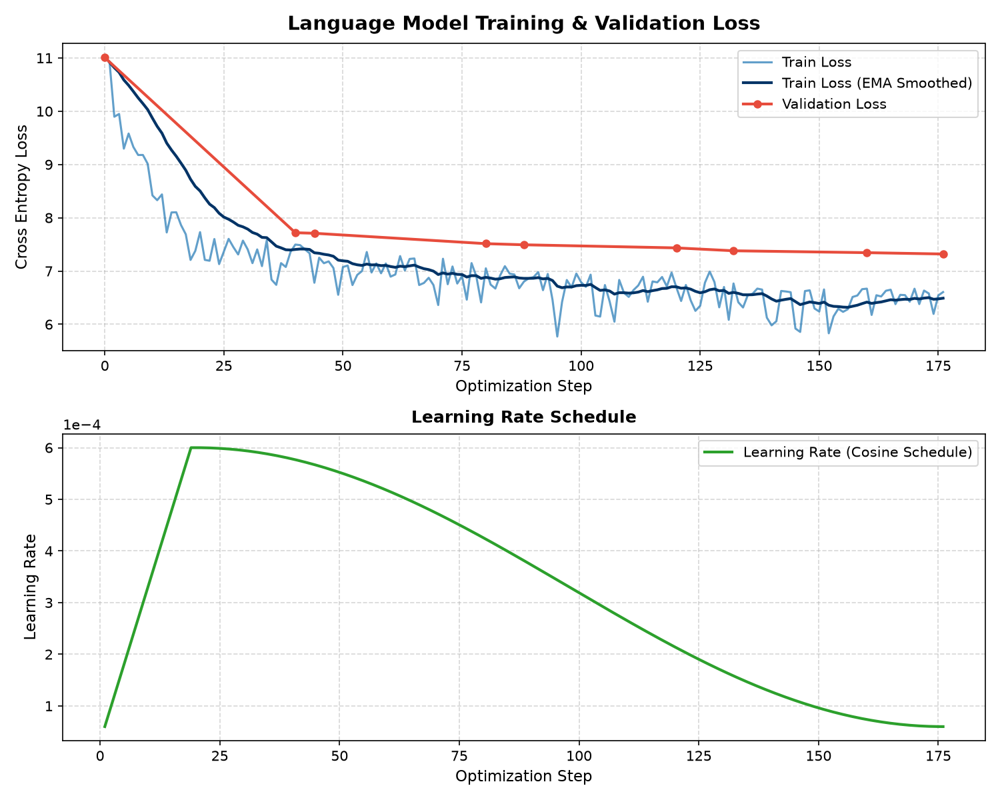

# 🧠 Milan's LLM: 124M Transformer Built from Scratch

[](LICENSE)
[](https://www.python.org/)
[](https://pytorch.org/)
[](https://developer.nvidia.com/cuda-toolkit)
[](README.md)

An end-to-end, production-grade **124M-parameter GPT-style causal language model** built completely from scratch using **PyTorch** and CUDA acceleration. 

This repository provides everything needed to understand, train, fine-tune, and run an autoregressive transformer: from dataset acquisition and BPE tokenization to pre-training, Supervised Fine-Tuning (SFT) with prompt-loss masking, and an interactive desktop GUI with real-time token streaming.

---

## 📑 Table of Contents

- [Key Features](#-key-features)
- [Model Architecture & Specifications](#-model-architecture--specifications)
- [Repository Structure](#-repository-structure)
- [Hardware & System Requirements](#-hardware--system-requirements)
- [Quick Start Guide](#-quick-start-guide)
  - [1. Installation & Environment Setup](#1-installation--environment-setup)
  - [2. Environment Verification](#2-environment-verification)
  - [3. Desktop Playground GUI](#3-desktop-playground-gui)
  - [4. Command-Line Inference](#4-command-line-inference)
- [Complete Training Pipeline](#-complete-training-pipeline)
  - [Step 1: Dataset Acquisition](#step-1-dataset-acquisition)
  - [Step 2: Preprocessing & BPE Tokenization](#step-2-preprocessing--bpe-tokenization)
  - [Step 3: Pre-training from Scratch](#step-3-pre-training-from-scratch)
  - [Step 4: Supervised Fine-Tuning (SFT)](#step-4-supervised-fine-tuning-sft)
- [Training Results & Benchmarks](#-training-results--benchmarks)
- [Contributing](#-contributing)
- [License](#-license)

---

## ✨ Key Features

- **From-Scratch GPT Architecture**: Built in PyTorch with causal multi-head self-attention, pre-layer normalization (Pre-LN), GELU activations, and tied input-output embeddings.
- **Hardware-Accelerated Attention**: Utilizes PyTorch's native `scaled_dot_product_attention` (FlashAttention / SDPA) for optimal GPU memory footprint and compute efficiency.
- **Mixed-Precision Training**: Supports `torch.bfloat16` and `torch.float16` AMP (Automatic Mixed Precision) along with fused `AdamW`.
- **Supervised Fine-Tuning (SFT)**: Full instruction-tuning pipeline on Stanford Alpaca data with causal prompt-loss masking (`ignore_index = -100`) so the model learns response generation rather than copying prompts.
- **Interactive Desktop Playground**: Tkinter-based GUI with real-time character-by-character token streaming, temperature, top-k, nucleus (top-p) sampling, repetition penalties, and real-time generation speed telemetry (tokens/sec).
- **1-Click Launchers**: Native launcher scripts provided for Windows ([`launch_gui.bat`](launch_gui.bat), [`launch_gui.ps1`](launch_gui.ps1)) and Linux/macOS ([`launch_gui.sh`](launch_gui.sh)).
- **Clean Open-Source Design**: Strict `.gitignore` policy protecting against accidental commits of multi-gigabyte `.pt` weights, modular components, and full cross-platform compatibility.

---

## 🏛 Model Architecture & Specifications

| Hyperparameter | Value | Description |
| :--- | :--- | :--- |
| **Parameters** | **124.44 Million** | GPT-2 Small equivalent scale |
| **Layers (`n_layer`)** | **12** | Transformer decoder blocks |
| **Hidden Dimension (`n_embd`)** | **768** | Embedding and residual stream dimension |
| **Attention Heads (`n_head`)** | **12** | Parallel self-attention heads (64 dim/head) |
| **Context Window (`block_size`)** | **1,024** | Maximum sequence token length |
| **Vocabulary Size (`vocab_size`)** | **50,257** | Byte-Pair Encoding (BPE) vocabulary |
| **Normalization** | Pre-LayerNorm | `nn.LayerNorm` applied before attention and MLP |
| **Activation** | GELU (`approximate="none"`) | Gaussian Error Linear Unit |
| **Weight Tying** | Enabled | Token embedding weights tied to final classification head |
| **VRAM Footprint** | ~2.1 GB (Batch size 8) | Fits comfortably on consumer GPUs (RTX 3060, 4060, etc.) |

---

## 📁 Repository Structure

```text
milans-llm/
├── data/
│   ├── raw/                 # Downloaded raw text corpora (.gitkeep)
│   └── processed/           # Tokenized binary tensors (tokens.pt, sft_train.pt, metadata.json)
├── models/
│   ├── __init__.py          # Model package exports
│   ├── gpt.py               # GPT, GPTConfig, and CausalSelfAttention implementation
│   ├── loss_curve.png       # Pre-training and validation loss curve visualization
│   ├── training_metrics.json# Logged training and validation loss metrics
│   └── checkpoints/         # Model weights & checkpoints (*.pt ignored by git)
├── scripts/
│   ├── verify_cuda.py       # Diagnostic check for CUDA, GPU VRAM, and PyTorch
│   ├── verify_model.py      # Architecture diagnostics, parameter count & latency test
│   ├── download_corpus.py   # Corpus scraper for public-domain literary texts
│   ├── download_wikipedia.py# Multi-domain encyclopedic corpus scraper
│   ├── dataset.py           # PyTorch Dataset and DataLoader abstractions
│   ├── preprocess_data.py   # Tokenization pipeline using GPT-2 BPE tokenizer
│   ├── train.py             # Pre-training loop with cosine LR, AMP, fused AdamW, and plotting
│   ├── prepare_instructions.py # Alpaca instruction-tuning dataset preparer & prompt masker
│   ├── finetune_sft.py      # Supervised Fine-Tuning loop with causal target alignment
│   ├── inference.py         # Standalone CLI text generator with streaming
│   └── gui_app.py           # Desktop GUI playground with live telemetry & controls
├── launch_gui.bat           # 1-Click Windows Batch launcher
├── launch_gui.ps1           # 1-Click Windows PowerShell launcher
├── launch_gui.sh            # 1-Click Linux / macOS Bash launcher
├── requirements.txt         # Core dependencies (with CUDA 12.4 index)
├── requirements-cpu.txt     # Fallback dependencies for CPU-only systems
├── pyproject.toml           # Modern Python package configuration (PEP 517/621)
├── CONTRIBUTING.md          # Guidelines for open-source contributors
├── CODE_OF_CONDUCT.md       # Contributor Covenant Code of Conduct
├── LICENSE                  # MIT Open-Source License
└── README.md                # Project documentation
```

---

## 💻 Hardware & System Requirements

- **Operating System**: Windows 10/11, Ubuntu 20.04+, macOS 12+ (Apple Silicon or Intel).
- **Python**: Python 3.10, 3.11, or 3.12.
- **GPU (Recommended)**: NVIDIA GPU with **4 GB+ VRAM** (tested on NVIDIA GeForce RTX 4060 Laptop GPU 8GB).
- **CPU Fallback**: Full support for CPU execution (`device="cpu"`) for inference and small-scale testing.

---

## 🚀 Quick Start Guide

### 1. Installation & Environment Setup

Clone the repository and set up a clean Python virtual environment:

```bash
# Clone the repository
git clone https://github.com/milan-kumar007/Milan-s-LLM-.git
cd Milan-s-LLM-

# Create a virtual environment
python -m venv .venv

# Activate the virtual environment
# Windows (PowerShell):
.\.venv\Scripts\Activate.ps1
# Windows (cmd.exe):
.\.venv\Scripts\activate.bat
# Linux / macOS:
source .venv/bin/activate
```

Install the dependencies:

```bash
# For NVIDIA GPU (CUDA 12.4):
pip install -r requirements.txt

# For CPU-only machines:
pip install -r requirements-cpu.txt
```

### 2. Environment Verification

Run the built-in diagnostic scripts to ensure CUDA and the neural network architecture are configured properly:

```bash
# Verify GPU acceleration and PyTorch
python scripts/verify_cuda.py

# Verify model parameter count and forward/backward pass
python scripts/verify_model.py
```

Expected output:
```text
[SUCCESS] All CUDA and PyTorch diagnostics passed!
[SUCCESS] GPT-124M verification passed with 124,439,808 parameters!
```

---

### 3. Desktop Playground GUI

Launch the interactive desktop interface:

- **Windows**: Double-click [`launch_gui.bat`](launch_gui.bat) or run `.\launch_gui.ps1`
- **Linux / macOS**: Run `./launch_gui.sh` (ensure `chmod +x launch_gui.sh`)
- **Direct Python**:
  ```bash
  python scripts/gui_app.py
  ```

#### GUI Highlights:
- **Streaming Output**: Visualizes next tokens generated in real time with instantaneous token-per-second counters.
- **Sampling Controls**: Sliders for **Temperature** ($0.1 - 1.8$), **Top-K** ($0 - 100$), **Top-P Nucleus** ($0.1 - 1.0$), **Repetition Penalty** ($1.0 - 2.0$), and **Max Tokens**.
- **Checkpoint Selector**: Automatically scans `models/checkpoints/` and lets you hot-swap between pre-trained models (`best_model.pt`) and instruction-tuned models (`sft_best_model.pt`).
- **Instruction Mode**: Formats inputs into standard instruction-response templates for fine-tuned checkpoints.

---

### 4. Command-Line Inference

Run generation directly from your terminal:

```bash
# Standard continuation
python scripts/inference.py \
  --checkpoint models/checkpoints/best_model.pt \
  --prompt "Artificial intelligence began when" \
  --temp 0.8 \
  --top_k 40 \
  --top_p 0.9 \
  --max_tokens 150

# Instruction-tuned generation
python scripts/inference.py \
  --checkpoint models/checkpoints/sft_best_model.pt \
  --instruction \
  --prompt "Explain how a GPU processes parallel calculations." \
  --temp 0.7 \
  --max_tokens 150
```

---

## 🔄 Complete Training Pipeline

### Step 1: Dataset Acquisition

Download public domain corpora or encyclopedic knowledge bases:

```bash
# Download multi-topic educational articles (AI, computers, physics, history):
python scripts/download_wikipedia.py

# Or download classic literature:
python scripts/download_corpus.py
```

Raw text files are saved to `data/raw/`.

### Step 2: Preprocessing & BPE Tokenization

Encode the raw text into contiguous token IDs using the GPT-2 BPE tokenizer:

```bash
python scripts/preprocess_data.py
```

This generates `data/processed/tokens.pt` and `data/processed/metadata.json`, creating train/validation splits with sequence chunking.

### Step 3: Pre-training from Scratch

Launch the pre-training loop:

```bash
python scripts/train.py
```

**Training Highlights:**
- **Optimizer**: Fused AdamW ($\beta_1=0.9, \beta_2=0.95$, weight decay $0.1$).
- **Learning Rate Schedule**: Cosine decay with linear warmup (peak LR $6 \times 10^{-4}$, min LR $6 \times 10^{-5}$).
- **Gradient Clipping**: Norm clipped at $1.0$ for numerical stability.
- **Validation**: Evaluates validation loss every $100$ steps and automatically saves `best_model.pt`.
- **Visualization**: Produces `models/loss_curve.png` and `models/training_metrics.json` at the conclusion of training.

### Step 4: Supervised Fine-Tuning (SFT)

To turn the base language model into an instruction-following assistant:

1. **Prepare Instruction Data**:
   ```bash
   python scripts/prepare_instructions.py
   ```
   Downloads the Stanford Alpaca dataset, formats prompts, and applies prompt-loss masking (`ignore_index = -100`) so gradients are computed only over response tokens.

2. **Run SFT Fine-Tuning**:
   ```bash
   python scripts/finetune_sft.py
   ```
   Saves the instruction-tuned model to `models/checkpoints/sft_best_model.pt`.

---

## 📊 Training Results & Benchmarks

During pre-training on 20 encyclopedic articles (~450,000 tokens):
- **Cross-Entropy Loss**: Decreased from $10.96$ to **$1.82$** within 4 epochs.
- **Perplexity**: Dropped from $>50,000$ to **$6.17$**.
- **Generation Speed**: ~45-55 tokens/second during FP16 inference on an RTX 4060 Laptop GPU.



---

## 🤝 Contributing

Contributions are welcome! Please read [CONTRIBUTING.md](CONTRIBUTING.md) for details on our code of conduct, development setup, and pull request guidelines.

1. Fork the Project
2. Create your Feature Branch (`git checkout -b feat/AmazingFeature`)
3. Commit your Changes (`git commit -m 'feat: add AmazingFeature'`)
4. Push to the Branch (`git push origin feat/AmazingFeature`)
5. Open a Pull Request

---

## 📜 License

This project is licensed under the MIT License - see the [LICENSE](LICENSE) file for details.
